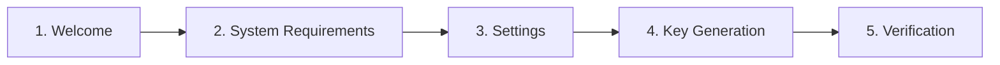

# Quick Start

This guide walks you through the initial setup wizard, server configuration, and everyday usage of the Expression Lab workspace.

:::important One-Time Setup Required
Before accessing Expression Lab, you must complete the onboarding wizard and add the generated configuration constants to your `wp-config.php` file.
:::

## Onboarding Wizard (Initial Setup)

Navigate to **Tools** > **Expression Lab** (or **Network Admin** > **Settings** > **Console** in WordPress Multisite).

If the plugin is not yet configured, the onboarding wizard will launch automatically.

<div className="desktop-window">
  
</div>



### 1. Welcome & Acknowledgement

Review the operational notice, check the acknowledgement box (and the End-User License Agreement checkbox in Professional Edition), and click **Begin install**.

### 2. System Requirements Check

The wizard automatically checks your server and browser environment. If any required dependency is marked as **Missing**, resolve it in your server configuration (see [Requirements](./installation.md#requirements)) before continuing.

### 3. Settings

Configure initial environment limits and defaults—such as read-only locks for Database, Filesystem, Network, and Hooks, execution time limits, signature validity duration, and optional license or MaxMind API credentials.

### 4. Key Generation & Passphrase

Enter a strong passphrase (minimum 8 characters):

* **Client-side derivation**: Your private key is derived locally in your browser using **Argon2id** and **Ed25519**.
* **In-memory session key**: Neither your passphrase nor the private key is stored in the database or written to disk; the key resides only in browser memory during your active session.

:::warning No recovery mechanism
Because the passphrase is never stored on the server, there is no way to recover or reset a forgotten passphrase. If you lose your passphrase, you must delete the configuration constants from `wp-config.php` and complete the onboarding wizard again.
:::

### 5. Server Ownership Verification

The wizard generates three PHP constants that must be added to your `wp-config.php` file:

```php title="wp-config.php"
define( 'EXPRESSION_LAB_ADMIN_USER_ID', 1 );
define( 'EXPRESSION_LAB_ADMIN_PUBLIC_KEY', 'your-base64-public-key...' );
define( 'EXPRESSION_LAB_ADMIN_SALT', 'your-base64-salt...' );
```

1. Open `wp-config.php` on your server.
2. Paste the three lines before the `/* That's all, stop editing! Happy publishing. */` comment.
3. Save the file and reload the Expression Lab admin page.

Once WordPress detects all three constants, the plugin completes installation and unlocks access to the workspace.

---

## Accessing Expression Lab

### Single Administrator Restriction

Access to Expression Lab is restricted to the administrator whose ID matches `EXPRESSION_LAB_ADMIN_USER_ID`.

Other users can see the plugin entry in the WordPress admin menu, but accessing the page will display an **Access Restricted** notice and prevent any operations or evaluations.

### Unlocking Your Session

When accessing **Tools** > **Expression Lab**, you will be prompted with a lock screen:

1. Enter the passphrase you chose during the onboarding process.
2. Click **Unlock** (or press <kbd>Enter</kbd>).
3. The browser derives the session key in memory and establishes a signed session.

---

## Using the Workspace

Expression Lab opens in a **Jupyter-like Notebook** workspace by default, while also supporting **Scratchpad** and **Console (REPL)** tabs for different diagnostic workflows.

<div className="desktop-window">
  
</div>

### 1. Notebook Cells & Editor

* **Code & Markdown Cells**: Add interactive DSL **Code** cells or rich **Markdown** documentation cells using the **+ Code** and **+ Markdown** buttons below a cell.
* **Cell Toolbar**: Each code cell provides a **Run** button, execution counter (`[1]`), and actions to format code (`{}`), save to the Snippet Library, move up/down, duplicate, or delete the cell.
* **Per-Cell Results (`Raw` / `Output`)**: Evaluated cells display results inline below the editor with **`Raw`** (raw DSL/JSON value) and **`Output`** (rich tables, trees, and Vega-Lite visualizations) tabs, along with copy, wrap, expand, and clear controls.
* **Other Tab Modes**: In **Scratchpad** tabs, a single full-height editor pairs with a toggleable bottom output panel; in **Console (REPL)** tabs, expressions execute line-by-line with <kbd>Enter</kbd> (<kbd>Shift</kbd> + <kbd>Enter</kbd> for newlines, <kbd>Alt</kbd> + <kbd>↑</kbd>/<kbd>↓</kbd> for history).

### 2. Top Toolbar Controls

* **Expression Lab Menu**: Application menu for file operations, settings, and version information.
* **Notebook File Actions**: Open and save `.elab` notebook files with optional password encryption (Professional Edition).
* **Run, Clear & Format**: Execute all cells in the active notebook (or run the current Scratchpad), clear cell outputs/session history, and format DSL/JSON code (<kbd>Shift</kbd> + <kbd>Alt</kbd> + <kbd>F</kbd>).
* **User Context Switcher**: Evaluate expressions in the context of another WordPress user account.
* **Site Switcher**: (*Multisite only*) Switch the execution context to target a specific subsite in the network.
* **Tools**: Quick access to visual builders and inspectors (**HTTP Request Builder**, **Database Query Builder**, **Entity Query Builder**, and **Filesystem Inspector**).
* **Library**: Opens the [Snippet Library](../features/snippet-library.md) to save, tag, load, import, or export reusable expressions (with optional local filesystem sync via the browser's [File System Access API](https://developer.mozilla.org/en-US/docs/Web/API/File_System_API)).
* **Panel Toggles**: Toggle the bottom output panel (Scratchpad mode) and show or hide the right sidebar.

### 3. Tabs Bar

* **Multiple Tabs**: Keep multiple notebooks, scratchpads, and REPL console sessions open simultaneously.
* **New Tab**: Click `+` or its dropdown arrow to open a new **Notebook**, **Scratchpad**, or **Console** tab.
* **Tab Management**: Close tabs (`×`), double-click a tab title to rename it, or drag and drop tabs to reorder your workspace.

### 4. Right Sidebar

* **`Symbols` Tab**: Searchable explorer listing available **Objects** (`Cache`, `Console`, `Database`, `Files`, `Graph`, `Http`, `IPLookup`, `Media`, `NetworkOptions`, `NetworkSites`, `Options`, `Posts`, `Users`), **Functions**, and **Constants**. Click any symbol to insert it into the active editor.
* **`Outline` Tab**: Displays the active notebook's cells and Markdown headings for quick navigation across large notebooks.

### 5. Status Bar

* **Sensitive Info Toggle** (`Eye` / connection icon): Masks or reveals `Server` and `User` IP addresses.
* **Runtime Info**: Displays active `PHP` and `WP` versions along with `Debug` mode status.
* **Read-Only Status Indicators**: Shows whether **Database**, **Files**, and **Network** write operations are `Locked` or `Unlocked`.
* **Signature Status**: Displays the remaining validity countdown (`Signed MM:SS`) for the active cryptographic session challenge.

---

## Your First Expression

Once unlocked, test the workspace by typing a basic expression into the first code cell:

```elscript
2 + 2 * 10
```

Click the cell's Run button (or press <kbd>Ctrl</kbd> + <kbd>Enter</kbd> / <kbd>Cmd</kbd> + <kbd>Enter</kbd>). The result appears in the cell's output panel:

```elscript
22
```

That's it! You can now build interactive notebooks, evaluate DSL expressions, and inspect your WordPress environment.

---

## Resetting the Configuration

If you need to change your passphrase or designate a different administrator:

1. Open your `wp-config.php` file in a text editor.
2. Remove or comment out the following constants:
   ```php title="wp-config.php"
   // define( 'EXPRESSION_LAB_ADMIN_USER_ID', ... );
   // define( 'EXPRESSION_LAB_ADMIN_PUBLIC_KEY', '...' );
   // define( 'EXPRESSION_LAB_ADMIN_SALT', '...' );
   ```
3. Save `wp-config.php`.
4. Return to your WordPress admin dashboard and navigate to **Tools** > **Expression Lab** to restart the onboarding wizard.

---

## Next Steps

* Read the [Basic Syntax](./basic-syntax) guide to explore available operators, functions, and expression grammar.
