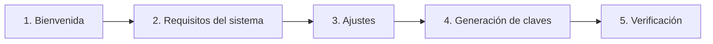

# Inicio rápido

Esta guía detalla el proceso para completar la configuración inicial, registrar las credenciales en el servidor y utilizar el espacio de trabajo de Expression Lab.

:::important Configuración inicial obligatoria
Antes de acceder a Expression Lab, es necesario completar el asistente de bienvenida y añadir las constantes de configuración generadas al archivo `wp-config.php`.
:::

## Asistente de configuración inicial (*Onboarding*)

En el panel de WordPress, acceder a **Herramientas** > **Expression Lab** (o a **Administración de la red** > **Ajustes** > **Consola** en entornos WordPress Multisite).

Si el plugin aún no ha sido configurado, el asistente se inicia de inmediato.

<div className="desktop-window">
  
</div>



### 1. Bienvenida y aceptación

Revisar el aviso operativo, marcar la casilla de confirmación (así como la aceptación del Acuerdo de Licencia de Usuario Final / EULA en Professional Edition) y pulsar **Comenzar instalación**.

### 2. Comprobación de requisitos del sistema

El asistente verifica el entorno del servidor y del navegador. Si algún componente obligatorio figura como **No disponible (Missing)**, debe corregirse en la configuración del servidor (ver la sección de [Requisitos](./installation.md#requisitos)) antes de avanzar.

### 3. Ajustes

Configurar los límites y opciones iniciales del entorno: bloqueos de solo lectura para Base de datos, Sistema de archivos, Red y Hooks, tiempo máximo de ejecución, duración de la firma criptográfica y, de forma opcional, clave de licencia o clave API de MaxMind.

### 4. Generación de claves

Definir una contraseña (*passphrase*) segura (mínimo 8 caracteres):

* **Derivación en el navegador**: La clave privada se deriva en el navegador mediante **Argon2id** y **Ed25519**.
* **Clave de sesión en memoria**: Ni la contraseña ni la clave privada se almacenan en la base de datos ni se escriben en disco; la clave reside solo en la memoria del navegador durante la sesión activa.

:::warning Sin mecanismo de recuperación
Dado que la contraseña nunca se almacena en el servidor, no existe ningún mecanismo para recuperarla o restablecerla ante un olvido. En caso de pérdida, es necesario eliminar las constantes de configuración en `wp-config.php` y reiniciar el asistente inicial.
:::

### 5. Verificación de propiedad del servidor

El asistente generará tres constantes de PHP que deben añadirse al archivo `wp-config.php`:

```php title="wp-config.php"
define( 'EXPRESSION_LAB_ADMIN_USER_ID', 1 );
define( 'EXPRESSION_LAB_ADMIN_PUBLIC_KEY', 'tu-clave-publica-base64...' );
define( 'EXPRESSION_LAB_ADMIN_SALT', 'tu-salt-base64...' );
```

1. Abrir el archivo `wp-config.php` en el servidor.
2. Pegar las tres líneas antes del comentario `/* That's all, stop editing! Happy publishing. */`.
3. Guardar el archivo y recargar la página de administración de Expression Lab.

En cuanto WordPress detecte las tres constantes, el plugin finalizará la instalación y habilitará el acceso al espacio de trabajo.

---

## Acceso a Expression Lab

### Restricción a un administrador específico

El acceso a Expression Lab queda restringido al administrador cuyo ID coincida con `EXPRESSION_LAB_ADMIN_USER_ID`.

Cualquier otro usuario administrador que intente acceder verá una pantalla de aviso de **Acceso Restringido** y no podrá ejecutar expresiones ni consultar datos.

### Desbloqueo de la sesión

Al acceder a **Herramientas** > **Expression Lab**, se muestra la pantalla de desbloqueo:

1. Introducir la contraseña definida durante la configuración inicial.
2. Pulsar **Desbloquear** (o presionar <kbd>Enter</kbd>).
3. El navegador deriva la clave criptográfica en memoria e inicia la sesión firmada.

---

## Uso del espacio de trabajo

Expression Lab se inicia por defecto en un entorno de **notebooks tipo Jupyter**, además de incluir pestañas en modo **Scratchpad** y **Consola (REPL)** para distintos flujos de diagnóstico.

<div className="desktop-window">
  
</div>

### 1. Celdas de notebook y editor

* **Celdas de código y Markdown**: Añade celdas interactivas de código DSL o de documentación Markdown mediante los botones **+ Code** y **+ Markdown** debajo de cada celda.
* **Barra de herramientas de celda**: Cada celda de código incluye un botón de **ejecución**, contador de ejecución (`[1]`) y acciones para formatear (`{}`), guardar en la biblioteca de snippets, mover arriba/abajo, duplicar o eliminar la celda.
* **Resultados por celda**: Los resultados se muestran debajo de cada celda con las pestañas **`Raw`** (valor bruto DSL/JSON) y **`Output`** (tablas, árboles de datos y gráficos Vega-Lite), junto con controles para ajustar línea, copiar, expandir o limpiar la salida.
* **Otros modos de pestaña**: En pestañas **Scratchpad**, un editor completo se combina con un panel inferior de resultados; en pestañas **Consola (REPL)**, las expresiones se evalúan línea a línea con <kbd>Enter</kbd> (<kbd>Shift</kbd> + <kbd>Enter</kbd> para saltos de línea y <kbd>Alt</kbd> + <kbd>↑</kbd>/<kbd>↓</kbd> para el historial).

### 2. Controles de la barra superior

* **Menú de Expression Lab**: Menú de aplicación con acciones de archivo, ajustes e información de la versión.
* **Archivos de notebook**: Permite abrir y guardar archivos `.elab` con cifrado opcional por contraseña (Professional Edition).
* **Ejecutar, limpiar y formatear**: Ejecuta todas las celdas del notebook activo (o el script en Scratchpad), limpia las salidas o la sesión y formatea el código DSL/JSON (<kbd>Shift</kbd> + <kbd>Alt</kbd> + <kbd>F</kbd>).
* **Selector de contexto de usuario**: Permite evaluar expresiones simulando el contexto de otra cuenta de usuario de WordPress.
* **Selector de sitio**: (*Exclusivo para Multisite*) Cambia el contexto de ejecución hacia un subsitio específico de la red.
* **Herramientas**: Acceso directo a los asistentes visuales (**HTTP Request Builder**, **Database Query Builder**, **Entity Query Builder** y **Filesystem Inspector**).
* **Biblioteca**: Abre la [Biblioteca de snippets](../features/snippet-library.md) para guardar, etiquetar, cargar, importar o exportar fragmentos reutilizables (con soporte de sincronización local mediante la [File System Access API](https://developer.mozilla.org/es/docs/Web/API/File_System_Access_API)).
* **Conmutadores de panel (Extremo derecho)**: Muestran u ocultan el panel inferior de resultados (en modo Scratchpad) y la barra lateral derecha.

### 3. Barra de pestañas

* **Trabajo multipestaña**: Mantén varios notebooks, scratchpads y consolas REPL abiertos en paralelo.
* **Nueva pestaña**: Haz clic en `+` o en su flecha desplegable para abrir una nueva pestaña de **Notebook**, **Scratchpad** o **Consola**.
* **Gestión de pestañas**: Cierra pestañas (`×`), haz doble clic en el título para renombrarlas o arrástralas para reordenar tu espacio de trabajo.

### 4. Barra lateral derecha

* **Pestaña `Symbols`**: Explorador con buscador que lista los **Objetos** disponibles (`Cache`, `Console`, `Database`, `Files`, `Graph`, `Http`, `IPLookup`, `Media`, `NetworkOptions`, `NetworkSites`, `Options`, `Posts`, `Users`), **Funciones** y **Constantes**. Al hacer clic en cualquier símbolo se inserta en el editor activo.
* **Pestaña `Outline`**: Muestra la estructura de celdas y encabezados Markdown del notebook activo para navegar rápidamente por documentos extensos.

### 5. Barra de estado

* **Ocultar/mostrar datos sensibles**: Permite enmascarar o mostrar las direcciones IP de `Server` y `User`.
* **Información del entorno**: Indica las versiones activas de `PHP` y `WP`, junto con el estado del modo `Debug`.
* **Indicadores de solo lectura**: Muestra si las operaciones de escritura para **Database**, **Files** y **Network** se encuentran bloqueadas (`Locked`) o habilitadas (`Unlocked`).
* **Validez de la firma**: Cuenta regresiva (`Signed MM:SS`) con el tiempo restante de validez del desafío criptográfico activo.

---

## Primera expresión de prueba

Tras desbloquear el entorno, introduce una operación básica en la primera celda de código:

```elscript
2 + 2 * 10
```

Pulsa el botón de ejecución de la celda (o presiona <kbd>Ctrl</kbd> + <kbd>Enter</kbd> / <kbd>Cmd</kbd> + <kbd>Enter</kbd>). El resultado aparecerá en el panel de salida inferior:

```elscript
22
```

A partir de este punto, puedes crear notebooks interactivos, evaluar expresiones DSL e inspeccionar las estructuras internas de WordPress.

---

## Restablecimiento de la configuración

Para cambiar la contraseña o designar a otro usuario administrador:

1. Abrir el archivo `wp-config.php` en un editor de texto.
2. Eliminar o comentar las constantes de autenticación:
   ```php title="wp-config.php"
   // define( 'EXPRESSION_LAB_ADMIN_USER_ID', ... );
   // define( 'EXPRESSION_LAB_ADMIN_PUBLIC_KEY', '...' );
   // define( 'EXPRESSION_LAB_ADMIN_SALT', '...' );
   ```
3. Guardar los cambios en `wp-config.php`.
4. Acceder nuevamente a **Herramientas** > **Expression Lab** para reiniciar el asistente de configuración.

---

## Siguientes pasos

* Consulta la guía de [Sintaxis básica](./basic-syntax) para conocer los operadores, funciones y la gramática del motor de expresiones.
